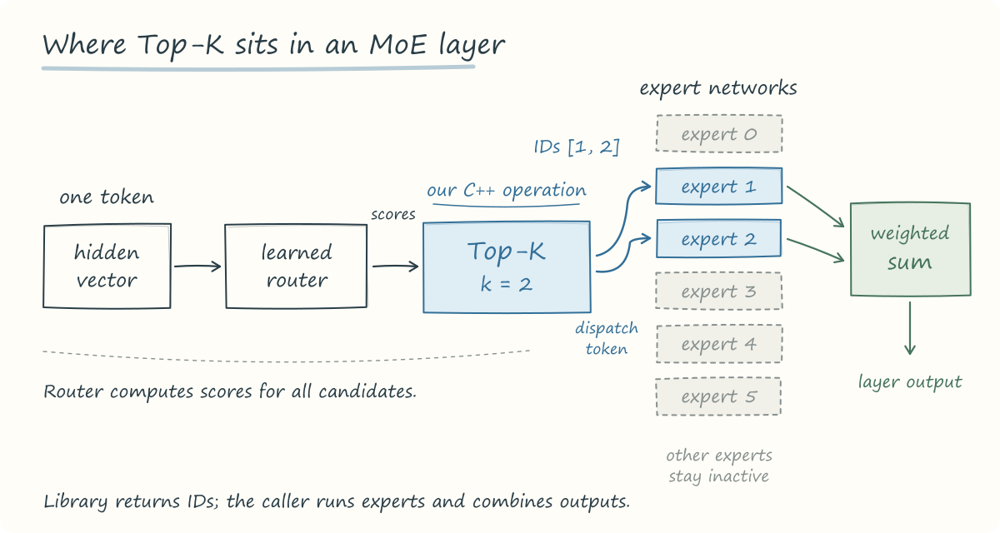
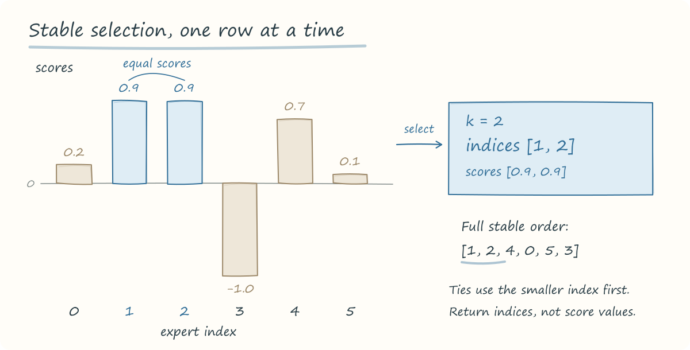

# Tensor kernels: CPU Top-K expert selection

A C++ extension for PyTorch that selects which experts should process each
token in a Mixture of Experts (MoE) layer. Given expert scores, it returns the
indices of the highest-scoring experts, with a fixed rule for ties.

The single-input entry point is `moe_ops.top8_experts(scores)`. A general
`moe_ops.topk_experts(scores, k)` operation is also available. Both use the
same CPU kernel.

Contributors are listed in [AUTHORS](AUTHORS).

## Why select experts?

In a language model, a token is a unit of text, often a word or part of a word.
Inside the network it is represented by a vector. A sparse MoE layer has
several expert networks and a router that assigns a score to each expert for
each token. The selected experts process that token; their outputs are
then combined using routing weights.

This lets the layer have more parameters available while using only a subset
of its experts for each token. The router learns the assignments during
training. An expert number is an index into a set of networks, rather than a
handwritten label such as "math" or "translation". The
[sparsely gated MoE paper by Shazeer et al.](https://arxiv.org/abs/1701.06538)
describes this form of conditional computation.

A recent example is
[Qwen3.8-2.4T-A95B](https://huggingface.co/Qwen/Qwen3.8-2.4T-A95B#model-overview).
Its MoE layers select 10 of 512 routed experts for each token and also run
one shared expert. The
[model configuration](https://huggingface.co/Qwen/Qwen3.8-2.4T-A95B/blob/main/config.json)
sets `num_experts=512` and `num_experts_per_tok=10`. Our general operation
expresses that selection as `topk_experts(scores, k=10)`; the top-8 wrapper
is a fixed-k convenience function.



*A schematic MoE layer, drawn with six experts and k=2 so the paths are readable.
The blue box is the operation implemented in this repository.*

## What this library receives and returns

The input is a tensor of scores that a router has already computed. The
operation returns expert indices. A caller can use those indices to gather
weights and dispatch token vectors to the selected networks. Router training,
expert execution, load balancing, and combining expert outputs are outside
the operation.

```python
import torch
from moe_ops import topk_experts

# Two tokens, six candidate experts per token.
scores = torch.tensor([
    [0.2, 0.9, 0.9, -1.0, 0.7, 0.1],
    [3.0, 0.1, -0.2, 0.0, 2.5, 2.5],
], dtype=torch.float32)

indices = topk_experts(scores, k=2)
print(indices)
# tensor([[1, 2],
#         [0, 4]])

selected_scores = scores.gather(dim=-1, index=indices)
# tensor([[0.9000, 0.9000],
#         [3.0000, 2.5000]])
```

The two rows make independent routing decisions.



For scores shaped `(batch, tokens, 512)`, `topk_experts(scores, k=10)` returns
indices shaped `(batch, tokens, 10)`. The leading dimensions can have any
rank; selection always happens along the last dimension.

## Operation

```python
import torch
from moe_ops import topk_experts, top8_experts

x = torch.tensor([0.2, 0.9, 0.9, -1.0])
print(top8_experts(x))      # tensor([1, 2, 0, 3])
print(topk_experts(x, k=2))  # tensor([1, 2])
```

`moe_ops.top8_experts(x)` is the fixed-k operation with reference:

```python
torch.argsort(x, dim=-1, descending=True, stable=True)[..., :8]
```

`moe_ops.topk_experts(x, k)` matches, for nonnegative integer k:

```python
torch.argsort(x, dim=-1, descending=True, stable=True)[..., :k]
```

The input must be a strided CPU float32 tensor with at least one dimension.
The last dimension contains expert scores; leading dimensions are preserved.
The output is int64, with last dimension `min(k, x.shape[-1])`. Equal scores
retain increasing input index order; NaNs precede numeric scores. Empty and
noncontiguous inputs are supported. Inputs are not modified.

C++ uses `std::partial_sort` on expert indices. Scalar inputs, other dtypes,
non-CPU devices, unsupported layouts, and negative k raise `RuntimeError`
through `TORCH_CHECK`. Selection returns discrete indices and has no gradient.

Ordering follows
[`torch.argsort(..., stable=True)`](https://docs.pytorch.org/docs/2.8/generated/torch.argsort.html).

## How the C++ operation works

The kernel first checks the device, layout, dtype, tensor rank, and k using
`TORCH_CHECK`. It materializes lazy negation and makes the scores contiguous
before reading their storage. The original input remains unchanged.

An index buffer is allocated once for the call. For each row, the kernel:

1. Resets that buffer to `0, 1, ..., E-1`, where E is the number of experts.
2. Uses `std::partial_sort` to place the best k indices at the front, ordered
   by descending score and then increasing index for ties.
3. Copies that prefix into the output and repeats for the next row.

Only the selected prefix needs to be ordered. For `2 <= k <= E`, partial
sorting takes roughly `O(E log k)` comparisons per row; a full sort takes
`O(E log E)`. The k=1 case is linear, and k=0 returns an empty output without
sorting. The index buffer has E entries and is reused between rows.
Noncontiguous inputs also require a contiguous copy.

The kernel releases Python's GIL while it runs. Rows are still processed
sequentially; releasing the GIL lets other Python threads make progress.

The Python API reaches C++ through `PYBIND11_MODULE`. The
[`CppExtension` and `BuildExtension` helpers](https://docs.pytorch.org/docs/2.8/cpp_extension.html)
compile and package the native module:

| File | Responsibility |
| --- | --- |
| [`src/moe_ops/ops.cpp`](src/moe_ops/ops.cpp) | Input checks, comparison rule, and selection loop |
| [`src/moe_ops/__init__.py`](src/moe_ops/__init__.py) | Exports `topk_experts` and defines the top-8 wrapper |
| [`setup.py`](setup.py) | Builds the C++ extension with PyTorch's build helpers |
| [`tests/test_topk.py`](tests/test_topk.py) | Checks the contract against the PyTorch expression |

## Build and install

Use Linux, Python 3.10-3.13, a C++17 compiler, and Python development headers.
Verified with Ubuntu 24.04, GCC 13, Python 3.12, and CPU PyTorch 2.8.0.
From the repository root:

```bash
python3 -m venv /tmp/moe-build
/tmp/moe-build/bin/pip install torch==2.8.0 --index-url https://download.pytorch.org/whl/cpu
PIP_EXTRA_INDEX_URL=https://download.pytorch.org/whl/cpu /tmp/moe-build/bin/pip wheel . --no-deps -w dist

python3 -m venv /tmp/moe-run
/tmp/moe-run/bin/pip install torch==2.8.0 --index-url https://download.pytorch.org/whl/cpu
/tmp/moe-run/bin/pip install dist/*.whl
(cd /tmp && /tmp/moe-run/bin/python -c 'import torch; from moe_ops import top8_experts; print(top8_experts(torch.tensor([0.2, 0.9, 0.9, -1.0])))')
```

The CPU index supplies PyTorch; PyPI supplies build tools. The wheel contains
our compiled extension, not PyTorch, and is specific to its Python ABI and platform.
The build and runtime both require PyTorch 2.8.0.

## Tests and container

Run the tests against the installed wheel from outside the source tree:

```bash
/tmp/moe-run/bin/pip install pytest
test_dir=$(mktemp -d)
cp -R tests "$test_dir/tests"
(cd "$test_dir" && /tmp/moe-run/bin/python -m pytest -q tests)
rm -rf "$test_dir"
```

The suite contains ten CPU tests covering output shape, output dtype, exact
reference comparisons, varied inputs, and errors raised by the C++ checks.

```bash
chmod 755 tools/smoke.sh
./tools/smoke.sh
docker build -t moe-topk:local .
docker run --rm moe-topk:local
```

The smoke script builds a Linux wheel, installs it into a fresh environment,
calls the functions outside the source tree, and prints `OK` on success.
The two-stage Ubuntu 24.04 image builds its own wheel and runs pytest by default.
The builder contains the compiler and headers. The final stage installs
PyTorch and the wheel, copies the tests, and runs them without the source tree.
This checks that the installed package carries its native module and that
the build does not depend on packages installed manually on a developer's
computer.

In an activated Linux virtual environment, `make wheel`, `make install`,
`make test`, and `make clean` automate the same workflow. `make smoke` runs
the installation check; `make docker` builds and runs the image.
GitHub Actions runs Ruff and tests the installed wheel on every push and pull request.

## Project note

- The implementation in commit 0bc76aa failed a reference comparison on a lazy
  negative view of `[1., 2., 3.]`: logical scores were `[-1., -2., -3.]`, but
  top-2 returned `[2, 1]` instead of `[0, 1]`. Fix commit 038e796 materializes
  negation with `resolve_neg()` before reading storage. The reproducer uses
  `torch._neg_view(torch.tensor([1.,2.,3.]))`.
- In commit 432bad1, a long native call still held Python's GIL, preventing another
  Python thread from progressing. Fix commit 04b6a16 releases the GIL during C++
  execution. A heartbeat
  check observed progress during the call after the fix; concurrent results and
  error propagation were also verified.
- Float64 is deliberately unsupported: it raises `RuntimeError` with
  `topk_experts: expected torch.float32`. Rows are processed sequentially on CPU.

cProfile recorded **101 C++ calls totaling 1.212 seconds** for
`(8192, 128)` float32 input and k=8 on an Intel Core i7-12700H, CPU PyTorch 2.8.0,
one PyTorch thread. This includes 100 loop calls and one correctness-check call;
startup/import time is outside the reported C++ entry. Reproduce from the root:

```bash
/tmp/moe-run/bin/python -m cProfile -o /tmp/moe-topk.prof tools/profile_topk.py --tokens 8192 --experts 128 --k 8 --iterations 100 --threads 1
/tmp/moe-run/bin/python -c 'import pstats; pstats.Stats("/tmp/moe-topk.prof").strip_dirs().sort_stats("tottime").print_stats("topk_experts")'
```
